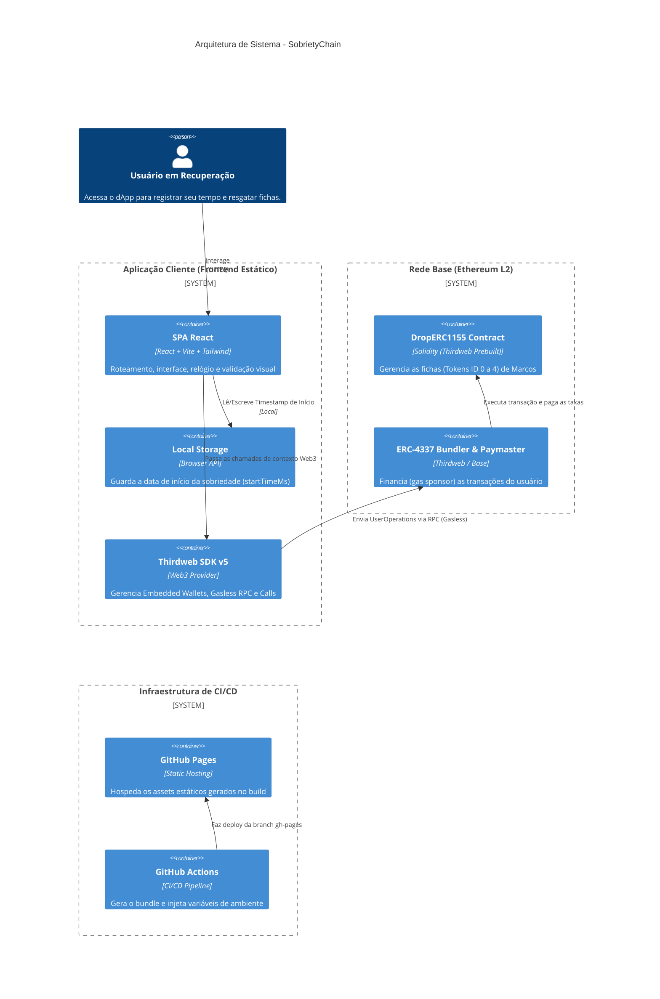
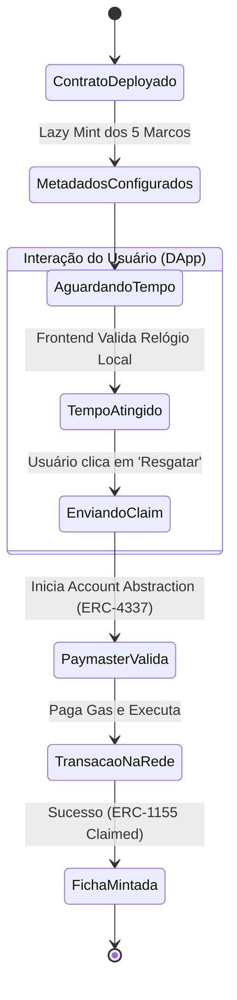
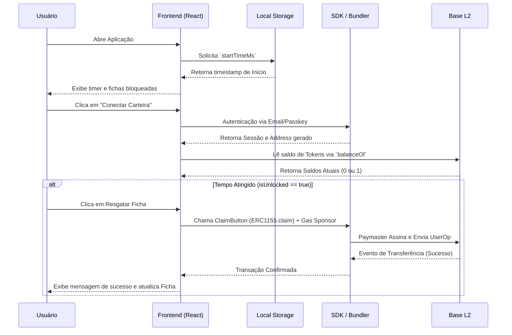

# Documentação Técnica: SobrietyChain

## 1. Conceito, Propósito e Estratégia

### Proposta de Valor
O **SobrietyChain (Serena)** é uma aplicação descentralizada (dApp) desenhada para digitalizar as tradicionais "fichas de sobriedade" de programas como Alcoólicos Anônimos (AA) e Narcóticos Anônimos (NA). Ele transforma as marcas de superação e sobriedade em ativos digitais on-chain imutáveis. O objetivo é permitir que membros registrem, de maneira eterna, gratuita e criptográfica, suas vitórias, recebendo fichas como NFTs comemorativas (Tokens ERC-1155) a cada marco alcançado (24 horas, 30 dias, etc).

### Estratégia Arquitetural
Para viabilizar este modelo respeitando a delicadeza do tema, o projeto adotou quatro pilares estratégicos:
*   **Privacidade e Anonimato Absoluto:** Utiliza as In-App Embedded Wallets da Thirdweb. O usuário pode fazer login usando um E-mail, Google Account, ou Passkey (ou até Guest mode). Nenhuma informação de identidade civil (KYC, CPF, Nome) é armazenada, respeitando os princípios das 12 tradições.
*   **Usabilidade (UX) e Acessibilidade:** O público-alvo pode não ter conhecimentos sobre Web3. O sistema abstrai conceitos como chaves privadas e redes, permitindo que a interação seja fluida como na Web2.
*   **Custos de Infraestrutura Zero para o Usuário:** Graças ao padrão Account Abstraction (ERC-4337) em conjunto com a rede Base (uma L2 da Ethereum de baixo custo), todas as taxas de gas são patrocinadas (gasless). O usuário consegue "mintar" (resgatar) sua ficha sem possuir saldo de ETH.
*   **Arquitetura Estática Descentralizada:** O frontend foi desenhado como uma Single Page Application (SPA) 100% estática. Sem um backend dependente (como Node.js/Python), todo o processamento de regras visuais é feito no cliente, interagindo diretamente com os Smart Contracts, e hospedado de forma resiliente e barata no GitHub Pages.

---

## 2. Arquitetura do Sistema e Stack Tecnológica

### Stack Tecnológica
Os manifestos do projeto (`package.json`, `.env.example`, `vite.config.ts`, e scripts) indicam o uso estrito das seguintes tecnologias:

*   **Frontend Framework:** React (v18.3.1) com TypeScript (v5.7.3).
*   **Build Tool & Dev Server:** Vite (v6.1.0).
*   **Estilização:** Tailwind CSS (v3.4.17) utilizando a biblioteca `clsx` e `tailwind-merge` para composição dinâmica de classes, além de ícones via `lucide-react`.
*   **Web3 & Contratos:** Thirdweb SDK v5 (`thirdweb` v5.88.0) - Abstrai conexão de carteira (Embedded Wallets), Account Abstraction, leitura de estado e execução de transações.
*   **Infraestrutura de Rede e Blockchain:** Rede **Base** e **Base Sepolia** (L2 do Ethereum).
*   **Ferramentas de Script / CLI:** Execução via `tsx` no backend Node local para facilitar deploys de configuração inicial (`scripts/deploy-contract.ts`).
*   **CI/CD:** GitHub Actions para o build e deploy estático.

### Diagrama de Arquitetura (Mermaid)



---

## 3. Engenharia dos Smart Contracts

Neste repositório, não há código fonte customizado `.sol` (Solidity). A estratégia de implementação técnica utilizada foi fazer uso de **contratos pré-publicados (Prebuilt) pelo Thirdweb**, especificamente o padrão **Edition Drop (DropERC1155)**.
O provisionamento é feito programaticamente via Infrastructure as Code (script `scripts/deploy-contract.ts`).

### Análise do Contrato Utilizado (DropERC1155)
*   **Padrão e Funcionalidade:** ERC-1155, permitindo gerenciar múltiplos tipos de tokens (Fichas) no mesmo endereço inteligente.
*   **Geração dos Metadados (Lazy Minting):** O contrato DropERC1155 é arquitetado para "Lazy Mint". Isso significa que as condições e metadados base de resgate são configurados de antemão pelo owner, mas os tokens só são formalmente mintados e indexados on-chain no exato momento do claim pelo usuário.
*   **Account Abstraction e Regras de Negócio de Mintagem:** A aplicação utiliza o `ClaimButton` no frontend. A transação é encapsulada em uma *UserOperation* via ERC-4337. O *Paymaster* cobrirá o *gas*. A mintagem real acontece na função genérica `claim` do ERC-1155. O script não introduz custo de venda (`_price = 0`).
*   **Cálculo de Tempo / Bloqueio (Limitações do Modelo Atual):** Como o contrato é prebuilt, **ele não possui o cálculo de tempo implementado on-chain**. A regra de negócio de "bloqueio" das fichas (verificar se o usuário já tem 24h, 30 dias, etc) é toda calculada do lado do cliente (Frontend). O contrato simplesmente delega e aceita requisições baseadas no Claim Condition genérico de acesso livre.
*   **Soulbound / Bloqueio de Transferência:** Por utilizar um contrato ERC-1155 padrão, **as fichas não são intrinsecamente intransferíveis (Soulbound ERC-5192)**. A priori, elas seriam transferíveis pelas funções de safeTransferFrom, uma vez que o Edition Drop da Thirdweb sem modificação específica suporta transferências.

### Ciclo de Vida e Estados



---

## 4. Arquitetura de Frontend e Integração Web3

### Estrutura de Diretórios e Componentes
A arquitetura é linear, seguindo padrões do Vite React:
*   **`src/config/contracts.ts`**: Mantém de forma estática as constantes da aplicação, incluindo metadados completos das 5 fichas (SOBRIETY_MILESTONES), além de puxar o endereço do contrato a partir das variáveis de ambiente (`VITE_EDITION_DROP_ADDRESS`).
*   **`src/client.ts`**: Instanciação estrita do `createThirdwebClient` (Thirdweb SDK v5), utilizado em todo o contexto Web3.
*   **`src/context/SobrietyContext.tsx`**: O cérebro do estado do frontend. Gerencia a lógica de tempo transcorrido através de um intervalo e do salvamento no `localStorage` do navegador sob a chave `sobrietychain_clean_start_ms`. Ele calcula propriedades derivadas (totalHours, progressToMilestone, isUnlocked).
*   **`src/components/Header.tsx`**: Implementa o botão `ConnectButton` fornecendo acesso a *In-App Wallets* e definindo o sponsor de gas (gasless).
*   **`src/components/SobrietyTimer.tsx`**: Interface para visualizar e alterar de modo interativo (inclusive "simular marcos" para fins de teste) a data base e os dias passados.
*   **`src/components/MilestoneCard.tsx`**: Representa visualmente cada ficha de sobriedade. Ele usa o hook `useReadContract(balanceOf)` do Thirdweb para checar o saldo e determinar on-chain se a ficha já foi reivindicada, mesclando com o estado local para exibir ou não o botão nativo do `ClaimButton`.

### Integração Web3 e Fluxo de Assinatura



---

## 5. Infraestrutura, Build e CI/CD

A aplicação foi criada para operar de maneira ultra barata e descentralizada, fugindo de servidores complexos. Tudo está configurado para publicação como site estático no GitHub Pages.

### Configurações de Build e Deploy
*   **Vite Config (`vite.config.ts`):** Tem a importante configuração de `base: './'`, o que força a injeção relativa de assets. Isso garante que a aplicação funcionará em um sub-caminho ou direto no root da hospedagem.
*   **Tratamento de Rotas no SPA:** No build action, é feito um `cp dist/index.html dist/404.html` para permitir navegação do Router (fallback no GitHub Pages).
*   **GitHub Actions (`.github/workflows/deploy.yml`):**
    O workflow intercepta o repositório a cada commit na `main`.

### Fluxograma do Pipeline CI/CD

```mermaid
flowchart LR
    A[Git Push na Main] --> B[GitHub Actions Runner (Ubuntu)]
    B --> C[Checkout & Setup Node.js 20]
    C --> D[Instalar Dependências (npm ci)]
    D --> E[Build do Vite & Injeção de Env Vars]
    E --> F[Copiar index.html para 404.html]
    F --> G[Upload Artifact (dist)]
    G --> H((Deploy no GitHub Pages))
```
*   *Nota de Configuração:* As chaves sensíveis e IDs de ambiente (ex: VITE_THIRDWEB_CLIENT_ID e VITE_EDITION_DROP_ADDRESS) são injetadas no passo E vindo dos *Secrets* configurados no repositório GitHub.

---

## 6. Diagnóstico do Estado Atual e Próximos Passos

### Mapeamento: O que está Funcional e Integrado
*   ✅ **Integração Web3 e Account Abstraction:** As in-app wallets da Thirdweb e a delegação gasless estão implementadas nos componentes perfeitamente.
*   ✅ **Interface de Usuário:** O design responsivo, renderização visual de cartões, contagem em tempo real de ticks e efeitos (glow, glassmorphism) via Tailwind estão finalizados.
*   ✅ **Lógica de Aplicação Frontend:** Integração com chamadas do SDK `useReadContract` e leitura/salvamento do Timer via Context API estão sólidos.
*   ✅ **Infraestrutura e Deploy:** Pipeline do GitHub Actions pronto e funcional.
*   ✅ **Infraestrutura as Code:** Script TypeScript de deploy via Thirdweb (`deploy-contract.ts`) funcional para configuração automatizada do `.env`.

### Mapeamento: O que está Mockado ou é Dívida Técnica (Riscos/Vulnerabilidades)
*   ⚠️ **Segurança da Lógica de Tempo (Cálculo puramente Client-Side):**
    O maior problema da arquitetura atual é que o validador de tempo reside no `SobrietyContext`, derivando do `localStorage`. Um usuário comum pode manipular o relógio do seu sistema, a variável no Local Storage ou usar os atalhos de "Simular" para bypassar a restrição de tempo. Não há barreira no *Smart Contract* para impedir a mintagem se chamada diretamente.
*   ⚠️ **Contrato Genérico e Falta de Soulbound (Transferibilidade):**
    O Edition Drop é um ERC-1155 comum. Sendo as fichas prêmios estritamente pessoais de recuperação, é um erro de conceito que elas possam ser vendidas ou transferidas. O ideal seria o token ser **Soulbound (ERC-5192)**.
*   ⚠️ **Armazenamento de Metadados Centralizado/Thirdweb Dependente:**
    Embora hospedado de forma descentralizada on-chain, as URIs e imagens dependem fortemente do dashboard de configuração (ou de IPFS gerenciado).

### Plano Técnico de Evolução e Próximos Passos
Considerando o escopo de segurança e descentralização, as próximas etapas devem priorizar a evolução do modelo de contrato inteligente:

1.  **Desenvolver um Smart Contract Customizado (Solidity):**
    *   Criar um contrato `SobrietySBT.sol` estendendo ERC-1155 mas sobrepondo (override) as funções de transferência `safeTransferFrom` e `safeBatchTransferFrom` para lançar `revert("Fichas sao intransferiveis")`.
2.  **Gravar o `startTime` On-Chain:**
    *   Implementar no contrato uma struct que mantenha a *Data de Início da Sobriedade* por carteira (`mapping(address => uint256) public userStartTimes`).
    *   Criar uma função `startJourney()` para registrar on-chain essa data (o gas pode continuar sendo patrocinado pela AA ERC-4337).
    *   No momento do Mint, fazer validação temporal no contrato (`require(block.timestamp >= userStartTimes[msg.sender] + requiredTime, "Tempo nao atingido");`).
3.  **Desacoplar o Frontend do `localStorage`:**
    *   Ao implementar o passo 2, modificar o `SobrietyContext` para buscar a data através de `useReadContract(getUserStartTime, address)`. Se não houver, pedir para o usuário iniciar a jornada registrando na rede Base.
4.  **Melhorar Tratamento de Recuperação e Recaída:**
    *   O recurso de "Reiniciar Relógio" deve acionar o smart contract para resetar a data e, dependendo da regra de negócio, queimar ou invalidar temporariamente os tokens anteriores.
5.  **Refinar Metadados Totalmente On-Chain:**
    *   Codificar os atributos (SVG) das fichas puramente em base64 direto pelo Smart Contract. Como o design tem poucas cores (apenas o brilho central), um SVG customizado seria perfeitamente encodado na blockchain sem custo excessivo.
