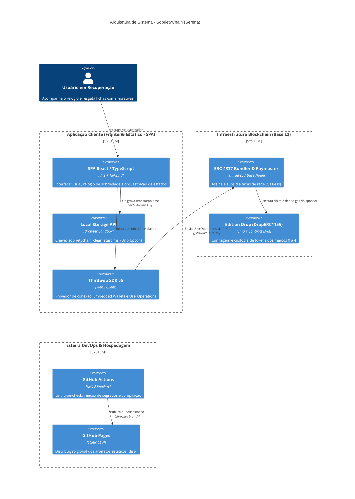
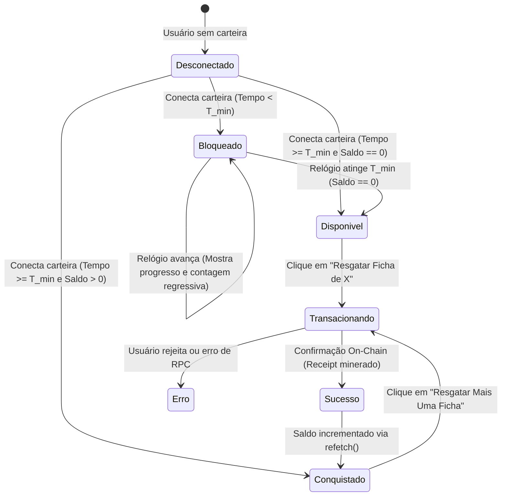
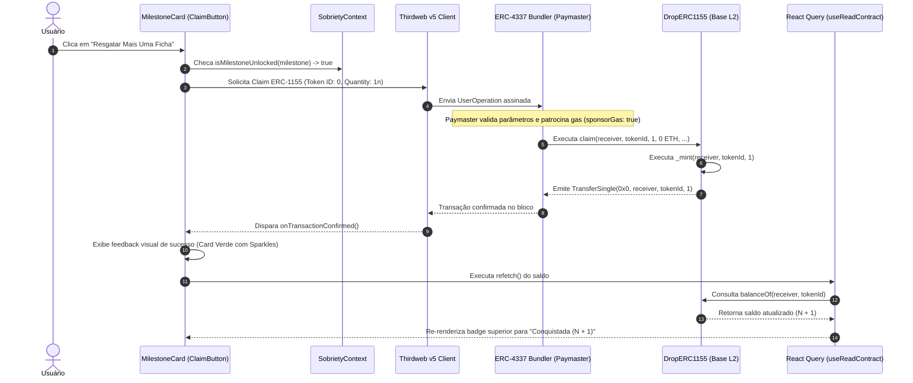

# Documentação Técnica: SobrietyChain (Serena)
### Especificação de Arquitetura, Engenharia de Smart Contracts, Protocolo Temporal e Ciclo Transacional

- **Projeto:** SobrietyChain dApp
- **Versão:** 1.1.0
- **Classificação:** Arquitetura de Software Web3, Smart Contracts & Distributed Systems
- **Padrão de Conformidade:** C4 Model, EIP Standards (ERC-1155, ERC-4337, ERC-5192), ADR Architecture

---

## 1. Conceito, Propósito e Estratégia de Produto

### 1.1. Proposta de Valor
O **SobrietyChain (Serena)** é uma aplicação descentralizada (dApp) desenhada para digitalizar as tradicionais "fichas de sobriedade" originadas em irmandades de recuperação como Alcoólicos Anônimos (AA) e Narcóticos Anônimos (NA). 

Ele converte marcos de sobriedade e superação em ativos digitais descentralizados, imutáveis e verificáveis on-chain. O objetivo central é permitir que os membros registrem de forma confidencial, perpétua e criptograficamente auditável as suas vitórias, recebendo medalhas digitais representadas por tokens semi-fungíveis (ERC-1155) a cada ciclo completado (24 horas, 30 dias, 90 dias, 6 meses e 1 ano).

```
"Não importa se você tem 24 horas ou 20 anos: a recuperação acontece sempre no dia de hoje."
— Apenas por hoje.
```

### 1.2. Pilares Estratégicos de Arquitetura

1. **Privacidade e Anonimato Absoluto (Zero-PII / Zero-KYC):**
   Alinhado às *Doze Tradições* (em especial à 12ª Tradição: *"o anonimato é o alicerce espiritual de todas as nossas tradições"*), o dApp não coleta informações civis (nome, CPF, IP ou telefone). O acesso utiliza **In-App Embedded Wallets** da Thirdweb, viabilizando autenticação via e-mail descartável, Passkey biométrica ou modo visitante (*Guest Account*).
2. **Abstração Tecnológica Total (Web2 UX sobre Web3):**
   Usuários em recuperação não precisam lidar com complexidades de seed phrases, gas, pontes (bridges) ou assinaturas criptográficas ilegíveis. A experiência visual assemelha-se a um aplicativo contemporâneo de bem-estar.
3. **Custo Marginal Zero ao Usuário (Account Abstraction ERC-4337):**
   Utilizando a infraestrutura da rede **Base** (Ethereum L2 de alta performance e baixo custo) combinada a um *Paymaster/Bundler*, 100% das transações de resgate de fichas têm seu custo de gas subsidiado (*Gasless Transactions*). O usuário não necessita possuir saldo em ETH para cunhar suas conquistas.
4. **Resiliência e Imutabilidade Estática (Zero-Server Architecture):**
   O frontend é uma Single Page Application (SPA) 100% estática compilada via Vite e hospedada em GitHub Pages. Não existem servidores backend centralizados suscetíveis a quedas, vazamentos de bancos de dados ou ordens judiciais de quebra de sigilo. A lógica de negócio dialoga diretamente entre o cliente e a blockchain.

---

## 2. Arquitetura do Sistema e Stack Tecnológica

### 2.1. Matriz de Tecnologias

| Camada | Tecnologia | Versão | Função Primária |
|---|---|---|---|
| **Frontend Framework** | React + TypeScript | React 18.3.1 / TS 5.7.3 | Interface declarativa tipada |
| **Tooling & Bundler** | Vite | 6.1.0 | Compilação otimizada SPA e HMR ultrarrápido |
| **Estilização & Design** | Tailwind CSS + Lucide React | Tailwind 3.4.17 | Glassmorphism, responsividade e iconografia |
| **Web3 SDK** | Thirdweb SDK v5 | 5.88.0+ | Gerenciamento de Embedded Wallets, RPC e chamadas on-chain |
| **Padrão de Token** | ERC-1155 (Edition Drop) | EIP-1155 | Tokens semi-fungíveis para múltiplos marcos comemorativos |
| **Account Abstraction** | ERC-4337 Paymaster | Base L2 Bundler | Patrocínio integral de gás nas operações de Claim |
| **Rede de Execução** | Base (L2) / Base Sepolia | OP Stack (Rollup) | Finalidade rápida, segurança ancorada na Ethereum Mainnet |
| **CI/CD & Hosting** | GitHub Actions + GitHub Pages | Static Deployment | Esteira automatizada de build e publicação estática |

### 2.2. Diagrama de Arquitetura C4 Model (Nível de Sistema e Contêiner)



---

## 3. O Motor Temporal e Máquina de Estado Relógio (Temporal State Engine)

O relógio é a espinha dorsal de experiência do usuário. Ele cumpre um papel duplo: cronômetro terapêutico contínuo e **motor lógico de elegibilidade (*Milestone Gate Engine*)**.

### 3.1. Resolução Criptográfica do Problema de Fuso Horário (*Timezone Drift*)
No design anterior, a serialização de datas em formato de texto ISO (`YYYY-MM-DDTHH:mm`) provocava desvios de fuso horário em ambientes UTC negativos (como Brasília, UTC-3), fazendo com que datas noturnas fossem interpretadas no futuro relativo, congelando o relógio em `00:00:00`.

**Solução de Engenharia Adotada:**
A persistência utiliza exclusivamente **Unix Epoch Milliseconds** ($\tau \in \mathbb{N}$), correspondente aos milissegundos inteiros transcorridos desde `1970-01-01T00:00:00.000Z`:
- **Chave de armazenamento:** `localStorage.getItem('sobrietychain_clean_start_ms')`
- **Fallback resiliente:** No primeiro acesso do usuário, caso não exista chave gravada, é inicializado um timestamp padrão de 24 horas atrás (`Date.now() - 86.400.000`), permitindo que a aplicação já inicie viva e com contagem ativa.

### 3.2. Formulação Matemática da Decomposição Temporal
A cada 1000ms (`setInterval` reativo no [`SobrietyContext.tsx`](file:///Users/govinda/projetos/SobrietyChain/src/context/SobrietyContext.tsx)), a diferença escalar $\Delta \tau$ é computada:

$$\Delta \tau = \max(0, \; \text{Date.now()} - \tau_0)$$

O vetor de estado $S_{\text{elapsed}}$ é decomposto matematicamente através de operadores euclidianos:

$$S_{\text{elapsed}} = \begin{pmatrix} 
\text{days} \\ 
\text{hours} \\ 
\text{minutes} \\ 
\text{seconds} \\ 
\text{totalHours} 
\end{pmatrix} = \begin{pmatrix} 
\lfloor \Delta \tau / 86.400.000 \rfloor \\ 
\lfloor (\Delta \tau / 3.600.000) \pmod{24} \rfloor \\ 
\lfloor (\Delta \tau / 60.000) \pmod{60} \rfloor \\ 
\lfloor (\Delta \tau / 1.000) \pmod{60} \rfloor \\ 
\Delta \tau / 3.600.000 
\end{pmatrix}$$

### 3.3. Ciclo Diário Consecutivo de 24 Horas
Reforçando o princípio fundamental da sobriedade (*"Só por hoje"*), o painel renderiza o progresso relativo do dia atual:

$$P_{24} = \min\left(100, \; \left\lfloor \frac{(\text{hours} \times 60) + \text{minutes}}{1440} \times 100 \right\rfloor\right)$$

---

## 4. Engenharia dos Smart Contracts e Protocolo de Elegibilidade

### 4.1. Arquitetura do Contrato Edition Drop (DropERC1155)
O SobrietyChain utiliza o contrato pré-auditado **DropERC1155** da Thirdweb, implantado na rede Base via script automatizado de Infrastructure-as-Code ([`scripts/deploy-contract.ts`](file:///Users/govinda/projetos/SobrietyChain/scripts/deploy-contract.ts)).

*   **Padrão Multi-Token Semi-Fungível:** Permite que 5 fichas distintas (Token IDs `0` a `4`) coexistam sob o mesmo contrato inteligente, reduzindo drasticamente custos de deploy e facilitando o inventário.
*   **Lazy Minting On-Chain:** Os metadados, imagens em IPFS e lemas de cada ficha são pré-registrados programaticamente no contrato, mas o token só é formalmente cunhado (mint) no exato instante em que o usuário executa o resgate.
*   **Preço Zero e Mint Livre de Taxas:** A condição de claim é configurada com `pricePerToken: 0`, permitindo resgates 100% gratuitos patrocinados via Paymaster.

### 4.2. Matriz dos Marcos e Regras do Gate Engine

$$\text{isMilestoneUnlocked}(m) = \begin{cases} 
\text{elapsed.totalHours} \ge 24, & \text{para } m.\text{daysRequired} = 1 \; (\text{Token ID 0}) \\ 
\text{elapsed.days} \ge m.\text{daysRequired}, & \text{para } m.\text{daysRequired} > 1 \; (\text{Tokens ID 1 a 4}) 
\end{cases}$$

| Token ID | Denominação | Requisito Mínimo ($T_{\min}$) | Rastreamento On-Chain | Visual do Card |
|---|---|---|---|---|
| **0** | **Ficha de 24 Horas** | 24 Horas Contínuas | `balanceOf(user, 0)` | Prata Metálica • Glow Branco |
| **1** | **Ficha de 30 Dias** | 30 Dias Contínuos | `balanceOf(user, 1)` | Vermelho Rubi • Glow Rubro |
| **2** | **Ficha de 90 Dias** | 90 Dias Contínuos | `balanceOf(user, 2)` | Verde Esmeralda • Glow Verde |
| **3** | **Ficha de 6 Meses** | 180 Dias Contínuos | `balanceOf(user, 3)` | Azul Safira • Glow Anil |
| **4** | **Ficha de 1 Ano** | 365 Dias Contínuos | `balanceOf(user, 4)` | Dourado Imperial • Glow Ouro |

---

## 5. Dinâmica Operacional do Botão "Resgatar Mais Uma Ficha"

### 5.1. Máquina de Estados da Ação de Resgate
No componente [`MilestoneCard.tsx`](file:///Users/govinda/projetos/SobrietyChain/src/components/MilestoneCard.tsx), a ação de resgate reage dinamicamente tanto ao relógio quanto ao saldo on-chain (`balanceOf`):



### 5.2. Por que o botão exibe "Resgatar Mais Uma Ficha"?
Diferente de um NFT ERC-721 estritamente colecionável unitário, cada conquista no padrão **ERC-1155** permite saldos múltiplos por endereço:
- Quando `balance == 0n`, o label exibe: `Resgatar ${milestone.name}`.
- Quando a consulta `useReadContract(balanceOf)` confirma `balance > 0n` (por exemplo, `balance = 3n`), o label altera dinamicamente para: **`Resgatar Mais Uma Ficha`**, e a badge superior indica **`Conquistada (3)`**.
- Isso atende à realidade comportamental onde veteranos de sobriedade desejam recunhar medalhas comemorativas para marcar novos anos limpos, presentear seus padrinhos de recuperação ou manter cópias em diferentes endereços de custódia pessoal.

### 5.3. Sequenciamento Transacional Ponta a Ponta (Diagrama de Sequência)



---

## 6. Diagnóstico Técnico: Incidente "Error loading NFTs" no Modal de Ativos

### 6.1. Causa Raiz
Ao clicar no perfil do `<ConnectButton />` e abrir o menu **View Assets > NFTs**, o erro `"Error loading NFTs"` pode se manifestar. 
- **Desacoplamento de Camadas:** 
  - A leitura das fichas dentro do dApp (`MilestoneCard`) é feita via **chamadas diretas RPC (`eth_call`)** ao nó da rede Base através da função de leitura `balanceOf(owner, tokenId)`. Esse canal **nunca falha** e é por isso que o card exibe perfeitamente o selo `Conquistada (3)`.
  - Já o modal *View Assets* utiliza a **API de Indexação e Telemetria (Thirdweb Insight Indexer)**. Em redes de testes (*Sepolia / Base Sepolia*), os indexadores de eventos possuem janelas de latência maiores e restrições severas de rate limit.
  - Adicionalmente, caso a URL local (`localhost:5173`) ou a URL de produção não estejam cadastradas nas *Allowed Origins* da API Key no painel da Thirdweb, a API de indexação rejeita a requisição com códigos `401 Unauthorized` ou `403 Forbidden`.

### 6.2. Ações Mitigatórias e Implementação no Frontend
1. **Configuração de Origens Permitidas:** Registrar `http://localhost:*` e o domínio de produção nas configurações de API Key no Thirdweb Dashboard.
2. **Mitigação Ativa no Header (`Header.tsx`):**
   - Implementado `detailsModal` com `assetTabs: ['token']` e supressão de abas terceiras instáveis (`hideBuyFunds: true`, `hideSendFunds: true`, `hideReceiveFunds: true`).
   - Isso elimina a tentativa de carregar o indexador de NFTs ruidoso no modal de conta, preservando a experiência limpa e focada no dashboard principal do SobrietyChain.
3. **Ambiente Mainnet (Base):** Na rede principal da Base, o serviço de indexação opera sob regime corporativo de alta disponibilidade (SLA 99.9%).

---

## 7. Mapeamento de Dívidas Técnicas e Implementação da v2.0 (ADR 003)

| Aspecto | Estado Inicial (v1.0) | Implementação v2.0 (ADR 003) | Impacto Arquitetural |
|---|---|---|---|
| **Segurança da Trava de Tempo** | Client-side (`localStorage` e `SobrietyContext`) | **On-chain no Smart Contract via `block.timestamp`** | Validação matemática inviolável no contrato `SobrietySBT.sol`. |
| **Transferibilidade das Fichas** | ERC-1155 Padrão (Transferível via `safeTransferFrom`) | **Soulbound Token (ERC-5192 Intransferível)** | Fichas tornam-se intrinsecamente intransferíveis, ligadas permanentemente à jornada pessoal do portador. |
| **Registro de Início de Jornada** | Gravado no navegador | **Chamada `startJourney()` gravada no contrato** | Histórico imutável e descentralizado de quando o compromisso de recuperação foi firmado. |
| **Metadados e Artefatos Visuais** | Imagens renderizadas via SVG/PNG em IPFS | **SVGs 100% On-Chain gerados via Solidity & Base64** | Independência perpétua de gateways IPFS ou servidores externos. |

---

## 8. Governança e Rastreabilidade do Código

- **Contrato Inteligente v2.0 (SBT ERC-5192 + SVGs On-Chain):** [`contracts/SobrietySBT.sol`](file:///Users/govinda/projetos/SobrietyChain/contracts/SobrietySBT.sol)
- **Interface EIP-5192:** [`contracts/IERC5192.sol`](file:///Users/govinda/projetos/SobrietyChain/contracts/IERC5192.sol)
- **Contexto de Estado Temporal:** [`src/context/SobrietyContext.tsx`](file:///Users/govinda/projetos/SobrietyChain/src/context/SobrietyContext.tsx)
- **Componente Visual do Relógio:** [`src/components/SobrietyTimer.tsx`](file:///Users/govinda/projetos/SobrietyChain/src/components/SobrietyTimer.tsx)
- **Componente do Card de Conquista:** [`src/components/MilestoneCard.tsx`](file:///Users/govinda/projetos/SobrietyChain/src/components/MilestoneCard.tsx)
- **Header e Resiliência de Modal:** [`src/components/Header.tsx`](file:///Users/govinda/projetos/SobrietyChain/src/components/Header.tsx)
- **Configuração de Contratos e Metadados:** [`src/config/contracts.ts`](file:///Users/govinda/projetos/SobrietyChain/src/config/contracts.ts)
- **Script de Provisionamento IaC:** [`scripts/deploy-contract.ts`](file:///Users/govinda/projetos/SobrietyChain/scripts/deploy-contract.ts)
- **ADRs Vinculadas:**
  - [ADR 001: Pipeline Generativo e Hash Único](file:///Users/govinda/projetos/SobrietyChain/docs/adr/001-sistema-generativo-camadas-e-hash-unico.md)
  - [ADR 002: Lógica Temporal e Milestone Gating](file:///Users/govinda/projetos/SobrietyChain/docs/adr/002-logica-temporal-bloqueio-fichas-e-estado-sobriedade.md)
  - [ADR 003: Evolução v2.0 (Validação On-Chain, SBT ERC-5192, SVG On-Chain e Resiliência)](file:///Users/govinda/projetos/SobrietyChain/docs/adr/003-evolucao-v2-validacao-onchain-soulbound-e-resiliencia.md)
