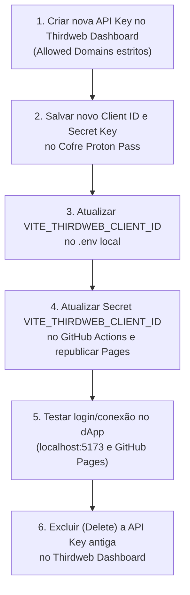

# Guia de Segurança: Rotação de API Key (`THIRDWEB_SECRET_KEY`) e Custódia Segura

- **Escopo:** Resposta a Incidentes, Rotação de Credenciais Sem Indisponibilidade (*Zero-Downtime*) e Higiene de Terminal
- **Componentes Afetados:** Thirdweb Dashboard, Cofre Proton Pass, `.env` Local e GitHub Actions Secrets (`.github/workflows/deploy.yml`)
- **Impacto On-Chain:** **Nenhum** (não exige novo deploy de contrato inteligente)

---

## 1. Visão Geral: O que Muda e o que Permanece Intacto

Quando uma `THIRDWEB_SECRET_KEY` é exposta acidentalmente (em logs de terminal, capturas de tela, chats ou histórico de shell), ela deve ser **rotacionada e revogada** para impedir que terceiros utilizem sua cota de RPC dedicada ou drenem créditos de patrocínio de gás (*Paymaster / Account Abstraction*).

> [!IMPORTANT]
> Na arquitetura do Thirdweb SDK v5, o **`Client ID`** (público) e a **`Secret Key`** (privada) formam um par criptográfico único e inseparável (`Client ID` é derivado matematicamente da `Secret Key`). Por isso, **não é possível alterar apenas a Secret Key mantendo o mesmo Client ID** — a rotação consiste em criar um novo par de chaves, atualizar o novo `Client ID` na aplicação e excluir a chave antiga.

### Matriz de Impacto da Rotação

| Ativo / Componente | Precisa ser recriado ou alterado? | Explicação Técnica |
| :--- | :---: | :--- |
| **Smart Contract (`VITE_EDITION_DROP_ADDRESS`)** | **Não** | O contrato já está gravado na blockchain Base e independe da API Key da Thirdweb. |
| **Carteira Deployer (`ADMIN_PRIVATE_KEY`)** | **Não*** | A chave privada EVM é independente da conta Thirdweb. *(\*Só rotacione a carteira caso a `ADMIN_PRIVATE_KEY` também tenha sido exposta).* |
| **Fichas/NFTs dos Usuários** | **Não** | Todos os saldos e metadados permanecem intactos on-chain e no IPFS. |
| **`THIRDWEB_SECRET_KEY` & `VITE_THIRDWEB_CLIENT_ID`** | **Sim** | O par comprometido será substituído pelo novo par gerado no painel. |
| **GitHub Actions Secret (`VITE_THIRDWEB_CLIENT_ID`)** | **Sim** | O workflow de build estático do GitHub Pages precisa receber o novo `Client ID`. |

---

## 2. Fluxo de Rotação Zero-Downtime (Criar Antes de Revogar)

Para não interromper o funcionamento do dApp publicado enquanto você atualiza as configurações, siga sempre a ordem **Criar Nova $\to$ Atualizar Ambientes $\to$ Validar $\to$ Revogar Antiga**:



---

## 3. Passo a Passo Operacional

### Passo 1: Criar a Nova API Key no Thirdweb Dashboard
*(Mantenha a chave antiga ativa temporariamente até concluir o Passo 4).*

1. Acesse o [Thirdweb Dashboard > Settings > API Keys](https://thirdweb.com/dashboard/settings/api-keys).
2. Clique em **Create API Key**.
3. Defina um nome descritivo com versão ou data (ex: `SobrietyChain-Prod-v2`).
4. Em **Allowed Domains (Domain Restrictions)**, configure **estritamente** as origens legítimas do projeto (separadas por vírgula ou linha):
   - `localhost:5173`
   - `govinda777.github.io` *(ou o seu domínio próprio exato)*
   > [!CAUTION]
   > **Jamais** selecione *"All Domains"* (`*`) nem utilize curingas abertos como `*.github.io` (que permitiriam a qualquer outro repositório do GitHub Pages consumir seu Client ID e seu Paymaster).
5. Certifique-se de manter habilitados os serviços utilizados pelo dApp:
   - **In-App Wallets / Embedded Wallets**
   - **Account Abstraction (Smart Wallets / Gas Sponsorship)**
6. Prossiga até a tela de exibição das chaves geradas. **Não feche o modal ainda**, pois a `Secret Key` só é exibida uma única vez no momento da criação.

---

### Passo 2: Atualizar a Custódia no Cofre (Proton Pass)

1. Abra o seu cofre no **Proton Pass** e localize o item de credenciais do projeto (ex: `SobrietyChain — Thirdweb API`).
2. Atualize os campos:
   - **Campo de Texto (`Client ID`):** Cole o novo `VITE_THIRDWEB_CLIENT_ID`.
   - **Campo Oculto / Hidden (`Secret Key`):** Cole a nova `THIRDWEB_SECRET_KEY`.
3. Salve o item no Proton Pass (o próprio Proton Pass mantém histórico de versões do registro caso precise auditar quando a troca foi realizada) e confirme no modal da Thirdweb que você guardou a chave em local seguro.

---

### Passo 3: Atualizar o Ambiente Local e Blindar o Terminal (`zsh`)

1. No arquivo `.env` na raiz do projeto, substitua o valor de `VITE_THIRDWEB_CLIENT_ID` pelo novo identificador público:
   ```dotenv
   VITE_THIRDWEB_CLIENT_ID=<SEU_NOVO_CLIENT_ID>
   ```
2. Na janela do terminal onde a chave antiga estava exportada, limpe a variável antiga da sessão:
   ```bash
   unset THIRDWEB_SECRET_KEY
   ```

#### Como injetar a nova `Secret Key` sem nunca exibi-la na tela (Modo Silencioso)

Para evitar que a sua nova `THIRDWEB_SECRET_KEY` apareça escrita no terminal (protegendo você ao compartilhar logs de erro, gravar a tela ou salvar histórico no `~/.zsh_history`), utilize o comando `read -rs` nativo do macOS (`zsh`):

```bash
echo -n "Cole sua THIRDWEB_SECRET_KEY (invisível) e pressione Enter: " && read -rs THIRDWEB_SECRET_KEY && export THIRDWEB_SECRET_KEY && echo " ✅ Carregada!"
```

- O parâmetro `-s` (*silent*) impede que os caracteres colados apareçam na tela.
- A variável fica disponível normalmente na memória da sessão atual para rodar `npm run deploy:contract` ou `npm run setup:tokens`, sem deixar rastros visuais no terminal nem no histórico de comandos!

*(A mesma técnica pode ser usada para a carteira administradora:)*
```bash
echo -n "Cole sua ADMIN_PRIVATE_KEY (invisível) e pressione Enter: " && read -rs ADMIN_PRIVATE_KEY && export ADMIN_PRIVATE_KEY && echo " ✅ Carregada!"
```

---

### Passo 4: Atualizar o GitHub Actions (GitHub Pages)

Como o deploy estático do projeto ([`.github/workflows/deploy.yml`](../.github/workflows/deploy.yml)) injeta `VITE_THIRDWEB_CLIENT_ID` durante o `npm run build` na nuvem:

1. No repositório do projeto no GitHub, acesse **Settings** $\to$ **Secrets and variables** $\to$ **Actions**.
2. Na aba **Secrets** (*Repository secrets*), clique no ícone de edição de **`VITE_THIRDWEB_CLIENT_ID`**.
3. Cole o `<SEU_NOVO_CLIENT_ID>` e clique em **Update secret**.
   > [!TIP]
   > Aproveite esta tela para conferir se `VITE_ACTIVE_CHAIN` está definido como `base-sepolia` (ou `base` em mainnet) e se `VITE_EDITION_DROP_ADDRESS` contém o endereço atualizado do contrato na rede correspondente.
4. Acesse a aba **Actions** do repositório no GitHub, selecione o workflow **Deploy SobrietyChain dApp to GitHub Pages** e clique em **Run workflow** (ou faça um novo `git push` na branch `main`) para publicar o bundle estático com o novo `Client ID`.

---

### Passo 5: Validar e Revogar Definitivamente a Chave Antiga

1. **Validação Local:** Execute `npm run dev`, abra `http://localhost:5173` e verifique se o botão **Entrar com Serenidade** conecta normalmente e carrega os marcos sem erros de autenticação.
2. **Validação em Produção:** Após o término do workflow no GitHub Actions, abra `https://govinda777.github.io/SobrietyChain/` e valide o carregamento.
3. **Revogação Definitiva:** Volte ao [Thirdweb Dashboard > Settings > API Keys](https://thirdweb.com/dashboard/settings/api-keys), localize a **API Key antiga** que havia vazado e clique em **Delete / Revoke**.
   - A partir desse exato segundo, a `THIRDWEB_SECRET_KEY` antiga torna-se permanentemente inválida em toda a infraestrutura da Thirdweb.

---

## 4. Checklist Rápido de Rotação

- [ ] Nova API Key criada no Thirdweb Dashboard com **Allowed Domains** restrito a `localhost:5173, govinda777.github.io`.
- [ ] Novo `Client ID` e nova `Secret Key` salvos no cofre **Proton Pass**.
- [ ] `VITE_THIRDWEB_CLIENT_ID` atualizado no arquivo `.env` local.
- [ ] Segredos no terminal carregados de forma invisível via `read -rs` (sem exposição em texto claro).
- [ ] Secret `VITE_THIRDWEB_CLIENT_ID` atualizado em **GitHub Settings > Secrets and variables > Actions** e workflow reexecutado.
- [ ] Conexão testada em `localhost:5173` e no GitHub Pages.
- [ ] API Key antiga **excluída/revogada** no Thirdweb Dashboard.
- [ ] Variáveis limpas da sessão do terminal após uso (`unset THIRDWEB_SECRET_KEY ADMIN_PRIVATE_KEY`).
