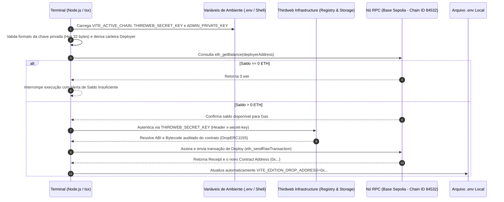

# Documentação Técnica e Guia de Troubleshooting: `npm run deploy:contract`

- **Escopo:** Provisionamento Automatizado de Smart Contracts (Infrastructure as Code - IaC)
- **Rede de Referência:** Base Sepolia Testnet (`Chain ID: 84532`) / Base Mainnet (`Chain ID: 8453`)
- **Stack de Execução:** Node.js + TypeScript (`tsx`) + Thirdweb SDK v5

---

## 1. Visão Geral do Comando (`npm run deploy:contract`)

O comando `npm run deploy:contract` executa o script de provisionamento automatizado ([`scripts/deploy-contract.ts`](../scripts/deploy-contract.ts)), responsável por implantar o contrato inteligente de forma determinística na blockchain sem depender de operações manuais em interfaces web.

### O que acontece nos bastidores (Fluxo Interno)



1. **Inicialização e Leitura de Ambiente:** O script verifica a existência do arquivo `.env` (criando-o a partir do `.env.example` caso não exista) e mescla com as variáveis de sessão exportadas no terminal.
2. **Derivação da Conta Administradora (Deployer):** A partir da `ADMIN_PRIVATE_KEY`, o SDK deriva localmente a chave pública e o endereço EVM que assinará a transação e receberá as permissões iniciais de administração (`DEFAULT_ADMIN_ROLE`) no contrato.
3. **Pré-validação de Gas (Preflight Check):** Antes de montar a transação, o script consulta o saldo nativo da carteira na rede alvo (Base Sepolia). Caso o saldo seja zero, a execução falha de forma controlada (fail-fast) antes de consumir recursos.
4. **Resolução de Artefatos e Deploy:** O SDK autentica na infraestrutura da Thirdweb para obter os artefatos verificados do contrato (ABI, bytecode e fábrica de clones/proxies) e transmite a transação assinada para a rede Base Sepolia.
5. **Persistência Automática:** Assim que o bloco é confirmado, o endereço do contrato recém-criado é gravado automaticamente na chave `VITE_EDITION_DROP_ADDRESS` do arquivo `.env`.

---

## 2. Pré-requisitos e Variáveis de Ambiente

A arquitetura separa estritamente **variáveis públicas de frontend** (prefixadas com `VITE_`, que são embutidas no bundle estático do navegador) de **segredos de infraestrutura e deploy** (usados exclusivamente em tempo de execução no terminal/CI).

### 2.1. Matriz de Variáveis Obrigatórias

| Variável | Escopo | Obrigatória no Deploy? | Descrição |
| :--- | :--- | :---: | :--- |
| `VITE_ACTIVE_CHAIN` | Frontend & CLI | **Sim** | Define a rede de destino (`base-sepolia` para testnet ou `base` para mainnet). |
| `VITE_THIRDWEB_CLIENT_ID` | Frontend (Público) | Sim | Identificador público da aplicação no Thirdweb Dashboard (restrito por domínio HTTP Origin). |
| `VITE_EDITION_DROP_ADDRESS` | Frontend (Público) | Gerado pelo Script | Endereço `0x...` do contrato implantado. Preenchido automaticamente após o deploy. |
| `THIRDWEB_SECRET_KEY` | **CLI / Backend (Secreto)** | **Sim** | Chave secreta da API da Thirdweb para autenticação server-side/terminal (enviada via header `x-secret-key`). |
| `ADMIN_PRIVATE_KEY` | **CLI / Deployer (Secreto)** | **Sim** | Chave privada hexadecimal de 32 bytes (`0x...`) da carteira administradora com saldo de gas na rede alvo. |

### 2.2. Configuração Segura no `.env.example`

O arquivo [`.env.example`](../.env.example) versionado no Git deve conter **apenas** a estrutura documentada, sem qualquer valor sensível:

```dotenv
# ============================================================================
# 1. VARIÁVEIS PÚBLICAS DE FRONTEND (Empacotadas pelo Vite)
# ============================================================================
VITE_THIRDWEB_CLIENT_ID=your_thirdweb_client_id_here
VITE_EDITION_DROP_ADDRESS=0x0000000000000000000000000000000000000000
VITE_ACTIVE_CHAIN=base-sepolia

# ============================================================================
# 2. CREDENCIAIS DE DEPLOY VIA TERMINAL (NUNCA prefixar com VITE_ nem comitar)
# Recomendado: Exportar apenas na sessão do terminal antes do deploy
# ============================================================================
# THIRDWEB_SECRET_KEY=your_thirdweb_secret_key_here
# ADMIN_PRIVATE_KEY=0x_your_64_hex_chars_private_key_here
```

### 2.3. Como Injetar os Segredos no Terminal

Em vez de salvar chaves privadas em arquivos de texto no disco, a prática recomendada é exportá-las temporariamente na sessão ativa do shell (recuperando-as do seu cofre de senhas criptografado, como o **Proton Pass**):

```bash
export THIRDWEB_SECRET_KEY="<SUA_THIRDWEB_SECRET_KEY>"
export ADMIN_PRIVATE_KEY="0x<SUA_CHAVE_PRIVADA_DEPLOYER>"
```

---

## 3. Boas Práticas de Segurança

### 3.1. Por que NUNCA habilitar "All Domains" (`*`) na API Key
No painel da Thirdweb, a configuração **Allowed Domains (Domain Restrictions)** protege o seu `VITE_THIRDWEB_CLIENT_ID` e o seu saldo de patrocínio de transações (*Paymaster / Account Abstraction*):

- **Risco de Drenagem de Cotas e Paymaster:** Como o `VITE_THIRDWEB_CLIENT_ID` é público e visível no código-fonte do navegador (aba *Network* do DevTools), se a opção **"All Domains"** (ou curingas amplos como `*.github.io`) estiver ativa, qualquer terceiro mal-intencionado pode copiar o seu `Client ID` para outro site e drenar seus créditos de RPC e seu saldo de patrocínio de gás.
- **Restrição Estrita de Origem (Origin Allowlist):** Mantenha a lista de domínios restrita exclusivamente aos hosts legítimos da aplicação (ex: `localhost:5173` para desenvolvimento local e o seu domínio específico de produção).

### 3.2. Segregação entre `Client ID` (Frontend) e `Secret Key` (Terminal/CLI)
- **`VITE_THIRDWEB_CLIENT_ID`:** Deve ser usado exclusivamente pelo aplicativo React no navegador. O navegador envia automaticamente o cabeçalho HTTP `Origin`, que a Thirdweb valida contra a lista de *Allowed Domains*.
- **`THIRDWEB_SECRET_KEY`:** Deve ser usada exclusivamente por scripts de linha de comando (`npm run deploy:contract`, `npm run setup:tokens`) ou servidores backend. Como o Node.js no terminal **não é um navegador** e não possui cabeçalho `Origin`, a `Secret Key` autentica a chamada de forma segura via cabeçalho `x-secret-key`, sem exigir que você afrouxe as regras de domínio do frontend.
- **Atenção:** Jamais adicione o prefixo `VITE_` à `THIRDWEB_SECRET_KEY` ou à `ADMIN_PRIVATE_KEY`, pois o Vite expõe qualquer variável prefixada com `VITE_` no código JavaScript público do cliente.
- **Rotação em Caso de Exposição:** Caso uma `THIRDWEB_SECRET_KEY` seja exposta acidentalmente em logs, chats ou capturas de tela, siga o procedimento completo em [`docs/API_KEY_ROTATION_GUIDE.md`](./API_KEY_ROTATION_GUIDE.md) para rotacionar o par de chaves sem indisponibilidade (*zero-downtime*) e injetar segredos de forma invisível no terminal (`read -rs`).

---

## 4. Guia de Troubleshooting (Erros Comuns e Como Resolver)

### 4.1. Erro: `RPC request failed with status 401 - : Unauthorized`

**Sintoma no Terminal:**
```text
❌ Falha ao realizar deploy do contrato: Error: RPC request failed with status 401 - : Unauthorized
    at fetchRpc (.../node_modules/thirdweb/src/rpc/fetch-rpc.ts:76:11)
```

**Causa Raiz:**
O script está sendo executado no terminal via Node.js utilizando apenas o `VITE_THIRDWEB_CLIENT_ID` (porque a variável `THIRDWEB_SECRET_KEY` não foi definida), enquanto a chave possui restrições de domínio (*Allowed Domains*) ativas no Thirdweb Dashboard. Como requisições originadas no Node.js não enviam o cabeçalho de navegador `Origin` autorizado, o gateway da Thirdweb (tanto nos RPCs auxiliares quanto no download de metadados IPFS) rejeita a conexão com HTTP `401 Unauthorized`.

**Como Resolver (Passo a Passo):**
1. Acesse o [Thirdweb Dashboard > Settings > API Keys](https://thirdweb.com/dashboard/settings/api-keys).
2. Localize a API Key do projeto (ou crie uma nova caso não tenha salvo a Secret Key original) e copie a **Secret Key** (guarde-a no cofre seguro, ex: Proton Pass).
3. Mantenha o **Allowed Domains** restrito (não marque *All Domains*).
4. No terminal, exporte a `THIRDWEB_SECRET_KEY` antes de rodar o comando:
   ```bash
   export THIRDWEB_SECRET_KEY="<SUA_SECRET_KEY>"
   npm run deploy:contract
   ```

---

### 4.2. Erro: `SALDO INSUFICIENTE PARA O DEPLOY` (`Insufficient Funds for Gas`)

**Sintoma no Terminal:**
```text
💰 Saldo atual: 0 ETH
⚠️ SALDO INSUFICIENTE PARA O DEPLOY NA BASE SEPOLIA
```
*(Ou erro de RPC: `insufficient funds for gas * price + value`)*

**Causa Raiz:**
A carteira derivada da `ADMIN_PRIVATE_KEY` não possui saldo suficiente de ETH nativo na rede **Base Sepolia (`Chain ID: 84532`)** para pagar a taxa de criação do contrato.
> **Nota Comum de Confusão:** Ter saldo na rede *Ethereum Sepolia (L1 - Chain ID 11155111)* não financia transações na *Base Sepolia (L2 - Chain ID 84532)*. Os fundos precisam estar na rede Base Sepolia.

**Como Resolver:**
1. Verifique o endereço exato exibido na linha `👤 Carteira Administradora: 0x...` do terminal.
2. Consulte o saldo da carteira em um explorador de blocos da Base Sepolia (`https://sepolia.basescan.org/address/<ENDERECO_DA_CARTEIRA>`) ou via RPC:
   ```bash
   curl -s -X POST -H "Content-Type: application/json" \
     -d '{"jsonrpc":"2.0","method":"eth_getBalance","params":["<ENDERECO_0x_AQUI>","latest"],"id":1}' \
     "https://sepolia.base.org"
   ```
3. Abasteça o endereço na **Base Sepolia** utilizando uma das opções:
   - **Faucet Direto L2:** Solicite Base Sepolia ETH em um faucet oficial (ex: Coinbase Developer Faucet, Alchemy Base Sepolia Faucet ou QuickNode Faucet).
   - **Transferência de outra carteira:** Envie uma pequena fração (ex: `0.005 ETH` a `0.01 ETH`) na rede Base Sepolia a partir de sua carteira pessoal para o endereço da carteira administradora.
   - **Bridge L1 $\to$ L2:** Caso possua ETH apenas na Sepolia L1, utilize a ponte oficial (`https://bridge.base.org/deposit`) para transferir de Sepolia para Base Sepolia.

---

### 4.3. Erro: `Formato da chave privada inválido` ou `ADMIN_PRIVATE_KEY inválida`

**Sintoma no Terminal:**
```text
❌ Erro: Formato da chave privada inválido.
   Esperado: Chave hexadecimal de 32 bytes (64 caracteres + 0x = 66 caracteres).
```

**Causa Raiz:**
- A variável `ADMIN_PRIVATE_KEY` não foi exportada na sessão atual do terminal;
- Foi copiado o **endereço público** (`0x...` de 42 caracteres) em vez da **chave privada** (`0x...` de 66 caracteres);
- Há espaços em branco, quebras de linha ou textos de placeholder (`sua_chave_aqui`).

**Como Resolver:**
1. Caso precise gerar uma nova carteira administradora dedicada ao projeto, execute:
   ```bash
   npm run create-wallet
   ```
2. Salve imediatamente o par Endereço Público + Chave Privada em seu gerenciador de senhas criptografado (ex: Proton Pass).
3. Exporte a chave privada garantindo que ela possui `0x` seguido de exatamente 64 caracteres hexadecimais (`0-9`, `a-f`):
   ```bash
   export ADMIN_PRIVATE_KEY="0x..."
   ```

---

### 4.4. Erro: `{ code: -32007, message: '25/second request limit reached' }` (RPC Rate Limit)

**Sintoma no Terminal:**
```text
❌ Falha ao realizar deploy do contrato: { code: -32007, message: '25/second request limit reached' }
```

**Causa Raiz:**
O script estava roteando chamadas para um endpoint RPC público não autenticado (como `https://sepolia.base.org`), que impõe um limite rígido de rajada (*burst limit*) de **25 requisições JSON-RPC por segundo**. Durante o `deployPublishedContract`, o SDK dispara múltiplas verificações em paralelo (`Promise.all` consultando fábricas CREATE2, implementações de proxy, estimativas de gás e nonces), estourando imediatamente a cota pública.

**Como Resolver:**
1. **Nunca sobrescreva** a definição da rede com RPCs públicos gratuitos (`defineChain({ rpc: 'https://sepolia.base.org' })`) em scripts de deploy automatizado.
2. Utilize as definições nativas de cadeia do pacote `thirdweb/chains` (`baseSepolia`, `base`, `sepolia`), que apontam automaticamente para o gateway dedicado da Thirdweb (`https://<chain_id>.rpc.thirdweb.com`) com suporte a *JSON-RPC batching* e alta vazão autenticada via `THIRDWEB_SECRET_KEY`.
3. Caso o limite tenha sido atingido em outra infraestrutura, aguarde alguns segundos e execute novamente com a `THIRDWEB_SECRET_KEY` exportada:
   ```bash
   export THIRDWEB_SECRET_KEY="<SUA_SECRET_KEY>"
   npm run deploy:contract
   ```

---

## 5. Checklist de Execução na Testnet (Passo a Passo do Zero)

Utilize este checklist operacional sempre que precisar provisionar ou migrar o contrato em um novo ambiente de testes (**Base Sepolia**):

- [ ] **1. Preparar o Arquivo `.env`:**
  Copie o template se ainda não existir e defina a rede alvo:
  ```bash
  cp -n .env.example .env
  ```
  Garanta que o `.env` contenha:
  ```dotenv
  VITE_THIRDWEB_CLIENT_ID=<SEU_CLIENT_ID>
  VITE_ACTIVE_CHAIN=base-sepolia
  ```

- [ ] **2. Gerar ou Recuperar a Carteira Deployer:**
  Se ainda não possuir uma carteira de deploy dedicada, gere uma nova e guarde-a no seu cofre seguro:
  ```bash
  npm run create-wallet
  ```

- [ ] **3. Garantir Fundos de Teste na Base Sepolia:**
  Confirme que o endereço público da carteira deployer possui ao menos `0.005 ETH` na rede **Base Sepolia** (`Chain ID: 84532`).

- [ ] **4. Configurar a API Key no Thirdweb Dashboard:**
  - Mantenha **Allowed Domains** restrito aos seus domínios autorizados (nunca use *All Domains*).
  - Copie a `THIRDWEB_SECRET_KEY` correspondente.

- [ ] **5. Exportar Segredos na Sessão do Terminal:**
  ```bash
  export THIRDWEB_SECRET_KEY="<SUA_SECRET_KEY>"
  export ADMIN_PRIVATE_KEY="0x<SUA_CHAVE_PRIVADA_64_HEX>"
  ```

- [ ] **6. Executar o Deploy do Contrato:**
  ```bash
  npm run deploy:contract
  ```
  *Resultado esperado:* O script exibirá `🎉 Contrato deployado com sucesso!` e atualizará automaticamente a variável `VITE_EDITION_DROP_ADDRESS` no arquivo `.env`.

- [ ] **7. Provisionar os Tokens e Condições de Resgate (Lazy Mint):**
  Logo após o deploy, na mesma sessão do terminal, cadastre os marcos e configure o claim gratuito:
  ```bash
  npm run setup:tokens
  ```

- [ ] **8. Limpar Segredos da Sessão do Terminal (Opcional, Recomendado):**
  Após concluir o deploy e o setup dos tokens, remova as variáveis sensíveis da memória do shell:
  ```bash
  unset ADMIN_PRIVATE_KEY
  unset THIRDWEB_SECRET_KEY
  ```
