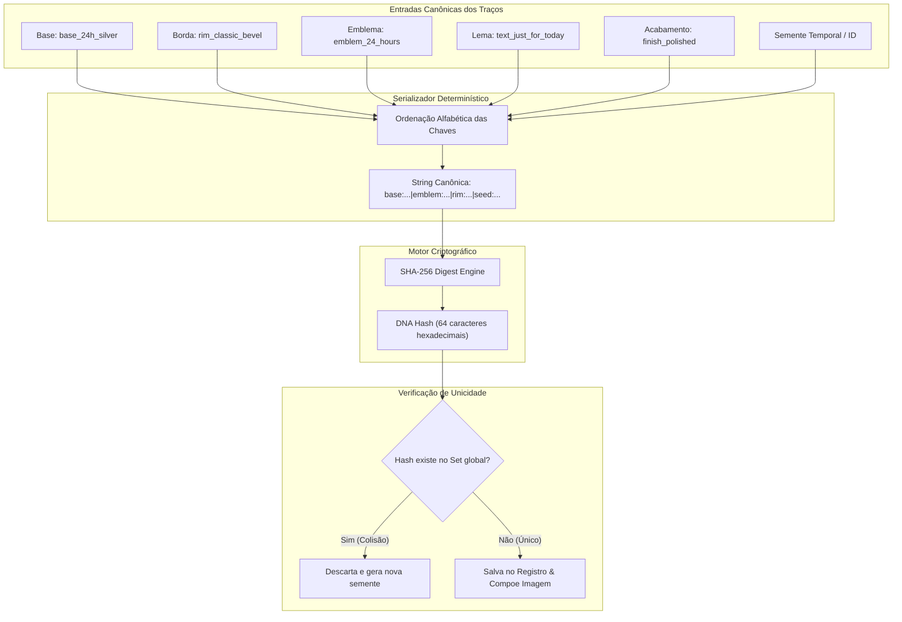
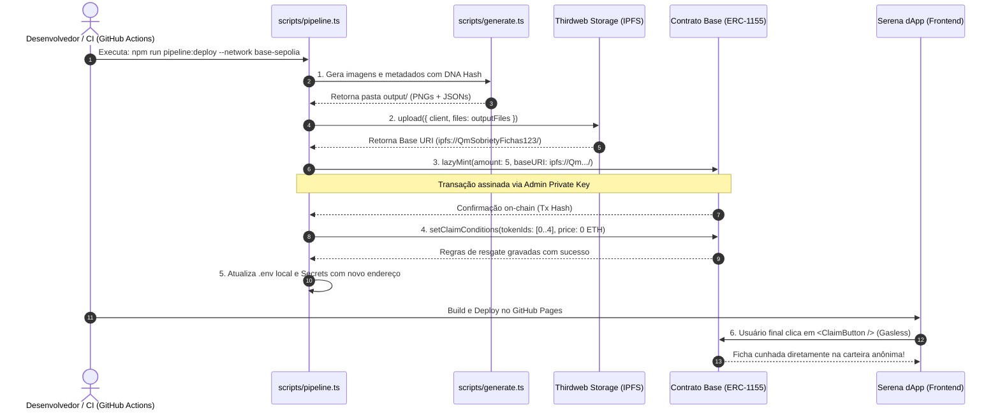

# ADR 001: Pipeline Generativo de Camadas, Hash Único (DNA) e Infraestrutura como Código (IaC) no Thirdweb

- **Status:** Aprovado
- **Data:** 2026-10-25
- **Decisores:** Arquiteto de Soluções Web3, Engenharia Frontend & DevOps
- **Referência:** Padrão arquitetural de [crypto-punks-generator](https://github.com/govinda777/crypto-punks-generator) e Thirdweb v5 SDK

---

## 1. Contexto e Motivação

No dApp **Serena**, os usuários conquistam medalhas e fichas de sobriedade on-chain com representação visual única e imutável.

Originalmente, o processo de subir coleções Web3 envolvia etapas manuais no Thirdweb Dashboard (clicar em botões, arrastar pastas no navegador para upload em lote e configurar permissões manualmente). Essa abordagem manual:
- É propensa a falhas operacionais e inconsistências humanas;
- Dificulta a reprodutibilidade idêntica entre ambientes (Testnet Base Sepolia vs. Mainnet Base);
- Impede a automação contínua via CI/CD (GitHub Actions).

### Objetivo desta ADR
Adotar uma arquitetura **100% Infraestrutura como Código (IaC) e Pipeline-as-Code**. Todas as etapas — desde a geração algorítmica das imagens e hashes criptográficos até o upload no IPFS, lazy-minting on-chain e configuração de regras de resgate (claim conditions) — são executadas **estritamente por scripts programáticos versionados em código**.

---

## 2. Visão Geral da Arquitetura (Diagrama Macro)

O fluxo completo funciona como uma esteira contínua e determinística:

```mermaid
flowchart LR
    subgraph S1["1. Gerador Local / CI"]
        A["Camadas PNG (1024x1024)"] --> B["Motor Sharp / Canvas"]
        B --> C["Cálculo SHA-256 (DNA)"]
        C --> D["output/ (Images + JSONs)"]
    end

    subgraph S2["2. Armazenamento Descentralizado"]
        D --> E["Thirdweb Storage SDK"]
        E --> F["IPFS Cluster (Pinning)"]
        F --> G["Base URI: ipfs://QmXy..."]
    end

    subgraph S3["3. Smart Contract (Base L2)"]
        G --> H["Extension: lazyMint"]
        H --> I["Extension: setClaimConditions"]
        I --> J["Tokens Prontos (0 ETH / Gasless)"]
    end

    subgraph S4["4. Experiência do Usuário"]
        J --> K["Serena dApp (Vite SPA)"]
        K --> L["Resgate via <ClaimButton />"]
    end
```



---

## 3. Modelo de Decomposição de Camadas (Layer Stacking)

Inspirado na técnica do `crypto-punks-generator`, as medalhas são compostas por uma pilha ordenada de imagens transparentes (Z-Index). Cada elemento gráfico é desenhado com alinhamento concêntrico perfeito:

### 3.1. Visão Esquemática da Sobreposição

```
                   [ CAMADA SUPERIOR / Z-INDEX 6 ]
                   ┌─────────────────────────────┐
                   │   06_finish (Pátina/Glow)   │ ──> Reflexos metálicos, luz volumétrica
                   └──────────────┬──────────────┘
                                  │
                   ┌──────────────▼──────────────┐
                   │  05_inscriptions (Lemas)    │ ──> "Apenas por hoje", "Serenidade"
                   └──────────────┬──────────────┘
                                  │
                   ┌──────────────▼──────────────┐
                   │ 04_center_emblem (Símbolos) │ ──> Numerais: XXIV, I, III, VI, 1 ANO
                   └──────────────┬──────────────┘
                                  │
                   ┌──────────────▼──────────────┐
                   │    03_coin_rim (Bordas)     │ ──> Chanfro clássico, anel de estrelas
                   └──────────────┬──────────────┘
                                  │
                   ┌──────────────▼──────────────┐
                   │   02_coin_base (Materiais)  │ ──> Prata, Carmim, Âmbar, Esmeralda, Safira
                   └──────────────┬──────────────┘
                                  │
                   ┌──────────────▼──────────────┐
                   │  01_background (Ambiente)   │ ──> Fundo escuro sereno / Transparente
                   └─────────────────────────────┘
                   [ CAMADA INFERIOR / Z-INDEX 1 ]
```

### 3.2. Anatomia Gráfica da Ficha de Sobriedade

```
                  ╭─────────────────────────────────╮
               ╭──╯          SERENA DAPP            ╰──╮
             ╭─╯     ★    ★    ★    ★    ★    ★        ╰─╮   <-- 03_coin_rim (Borda com Estrelas)
           ╭─╯                                         ╰─╮
          ╭╯     ╭─────────────────────────────────╮     ╰╮
         ╭╯      │         "APENAS POR HOJE"       │      ╰╮  <-- 05_inscriptions (Lema Curvo)
        ╭╯       ╰─────────────────────────────────╯       ╰╮
        │                                                   │
        │                    ╭─────────╮                    │
        │                    │  XXIV   │                    │  <-- 04_center_emblem (Marco Central)
        │                    │  HORAS  │                    │
        │                    ╰─────────╯                    │
        │                                                   │
        ╰╮       ╭─────────────────────────────────╮       ╭╯
         ╰╮      │       SOBRIEDADE & CORAGEM      │      ╭╯  <-- 02_coin_base (Textura Prata / Metal)
          ╰╮     ╰─────────────────────────────────╯     ╭╯
           ╰─╮                                         ╭─╮    <-- 06_finish (Gradiente de Luz Radial)
             ╰─╮     ★    ★    ★    ★    ★    ★        ╭─╯
               ╰──╮          REDE BASE              ╭──╯
                  ╰─────────────────────────────────╯
```

---

## 4. O Modelo de Geração Criptográfica de DNA (Hash Único)

Para garantir que cada token gerado seja matematicamente comprovável e livre de colisões, o sistema implementa um pipeline criptográfico determinístico:



### 4.1. Fórmula Matemática do DNA

$$\text{DNA Hash} = \mathcal{H}_{\text{SHA-256}}\left( \bigoplus_{i=1}^{n} \left( k_i \parallel \text{":"} \parallel v_i \parallel \text{"|"} \right) \parallel \text{"seed:"} \parallel \mathcal{S} \right)$$

Onde:
- $k_i$ são os identificadores das camadas ordenados lexicograficamente ($k_1 \le k_2 \le \dots \le k_n$).
- $v_i$ são os nomes dos arquivos PNG escolhidos.
- $\mathcal{S}$ é a semente de entropia (Timestamp Unix ou ID do Marco).

---

## 5. Comparativo: Método Manual vs. Pipeline IaC


| Critério | Abordagem Manual (Dashboard) | Abordagem IaC (Código Automatizado) |
| :--- | :--- | :--- |
| **Tempo de Execução** | ~30 a 45 minutos de cliques manuais | **Menos de 2 minutos** (1 comando) |
| **Reprodutibilidade** | Baixa (sujeita a esquecimento de passos) | **100% determinística** via código |
| **Rastreabilidade Git** | Nenhuma (feita direto no browser) | Total (PRs, histórico de commits e diffs) |
| **Ambientes (Staging/Prod)** | Requer refazer tudo na mão para Mainnet | Alternância instantânea via flag `--network` |
| **Integração CI/CD** | Impossível | **Nativa** via GitHub Actions |

---

## 6. Diagrama de Sequência da Execução do Pipeline IaC

O diagrama abaixo detalha a coreografia de chamadas entre os scripts, o nó IPFS e o contrato na rede Base:



---

## 7. Modelo de Metadados JSON Gerado

Para cada token cunhado, o gerador emite um arquivo JSON estritamente alinhado aos padrões **ERC-1155** e **OpenSea Standard**:

```json
{
  "id": "0",
  "name": "Ficha Serena #0000 — 24 Horas",
  "description": "Ficha comemorativa do primeiro ciclo de 24 horas de sobriedade. Apenas por hoje.",
  "image": "ipfs://QmSobrietyHash/0.png",
  "dna": "c5f1a9b7e3d824610538a0f2b963174e50821c97a34612e58749bc1365ad4820",
  "properties": {
    "category": "sobriety_milestone",
    "generation": 1,
    "tier": "Prata"
  },
  "attributes": [
    {
      "trait_type": "Marco Temporal",
      "value": "24 Horas"
    },
    {
      "trait_type": "Material da Moeda",
      "value": "Prata Fina 999"
    },
    {
      "trait_type": "Borda",
      "value": "Chanfro Clássico"
    },
    {
      "trait_type": "Emblema Central",
      "value": "XXIV Numeral"
    },
    {
      "trait_type": "Lema Gravado",
      "value": "Apenas por hoje"
    },
    {
      "trait_type": "Acabamento",
      "value": "Polido Brilhante"
    },
    {
      "trait_type": "Raridade",
      "value": "Comum"
    },
    {
      "trait_type": "DNA Hash",
      "value": "c5f1a9b7e3d824610538a0f2b963174e50821c97a34612e58749bc1365ad4820"
    }
  ]
}
```

---

## 8. Arquitetura dos Arquivos de Script no Projeto

A estrutura de código dedicada a esse pipeline dentro do repositório Serena:

```
SobrietyChain/
 ├── docs/
 │    └── adr/
 │         └── 001-sistema-generativo-camadas-e-hash-unico.md
 ├── generator/
 │    ├── layers/                       # Assets originais em PNG transparente (1024x1024)
 │    │    ├── 01_background/           # Planos de fundo
 │    │    ├── 02_coin_base/            # Materiais: prata, carmim, ambar, esmeralda, safira
 │    │    ├── 03_coin_rim/             # Anéis externos e relevos
 │    │    ├── 04_center_emblem/        # Numerais romanos e símbolos
 │    │    ├── 05_inscriptions/         # Frases inspiracionais
 │    │    └── 06_finish/               # Reflexos, pátina e iluminação
 │    └── output/                       # Diretório gerado (ignorado pelo git)
 │         ├── images/                  # 0.png, 1.png, 2.png, 3.png, 4.png
 │         └── metadata/                # 0.json, 1.json, 2.json, 3.json, 4.json
 ├── scripts/
 │    ├── generate.ts                   # Motor de camadas + cálculo SHA-256
 │    ├── upload-storage.ts             # Pinning em lote no IPFS via Thirdweb Storage
 │    ├── lazy-mint.ts                  # Registro on-chain dos tokens na Base
 │    ├── set-claim-conditions.ts       # Regras de resgate gratuito (0 ETH)
 │    └── pipeline.ts                   # Orquestrador unificado CLI
 └── .github/
      └── workflows/
           └── deploy-collection.yml    # Pipeline automatizado de CI/CD
```

---

## 9. Comandos Operacionais

O time opera a infraestrutura diretamente pelo terminal:

```bash
# 1. Testar apenas a geração local das imagens e cálculo dos hashes
npm run generate

# 2. Executar o pipeline completo em ambiente de testes (Base Sepolia)
npm run pipeline:deploy -- --network base-sepolia

# 3. Executar o pipeline completo em ambiente de produção (Base Mainnet)
npm run pipeline:deploy -- --network base
```

---

## 10. Conclusão

Com a aprovação desta ADR, o dApp Serena adota as melhores práticas de **Engenharia de Software Web3**, combinando:
1. **Arte generativa em camadas** no estilo consagrado do `crypto-punks-generator`;
2. **Identidade criptográfica imutável (DNA)** por meio de hashes SHA-256;
3. **Automação ponta a ponta (IaC)**, tornando o processo de publicação de coleções rápido, seguro, auditável e 100% livre de intervenções manuais em dashboards.
