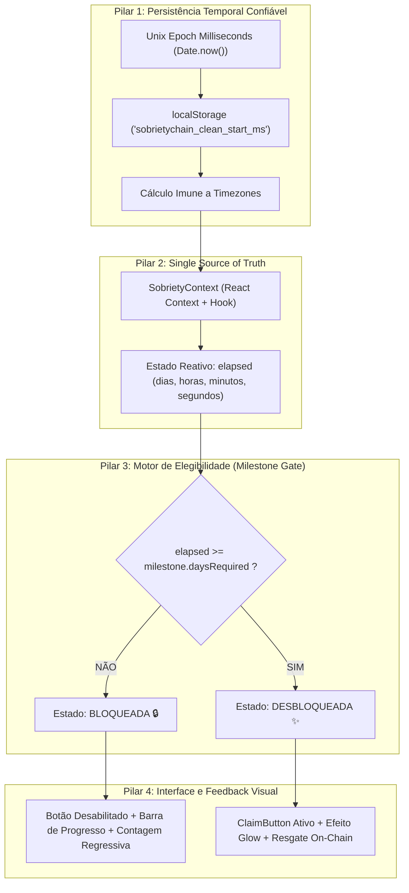
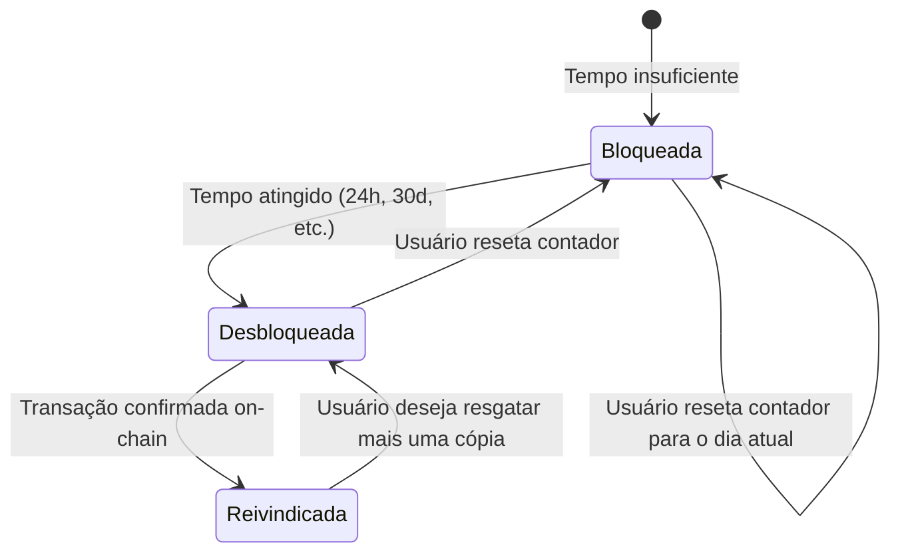

# ADR 002: Arquitetura de Estado Temporal, Resolução de Fuso Horário e Sistema de Desbloqueio Condicional de Fichas (Milestone Gating)

- **Status:** Proposto
- **Data:** 2026-10-25
- **Decisores:** Arquiteto de Soluções Web3, Engenharia Frontend
- **Contexto:** Relógio congelado em 00:00:00 e ausência de travas de elegibilidade nos cards de resgate de fichas.

---

## 1. Contexto e Problemas Observados

Durante os testes em ambiente local e pré-visualização no navegador, foram identificados dois problemas críticos de arquitetura e usabilidade:

### 1.1. Problema A: Congelamento do Relógio por Distorção de Fuso Horário (Timezone Drift)
O contador de 24 horas permaneceu congelado em:
$$\text{0 DIAS} \quad \text{00 HORAS} \quad \text{00 MINUTOS} \quad \text{00 SEGUNDOS}$$
- **Causa Raiz:** O componente utilizava `new Date().toISOString().slice(0, 16)` para persistir a data no `localStorage`.
- Em fusos horários ocidentais como o Brasil (BRT, UTC-3), o horário noturno (ex: 21:05 do dia 25) convertido para ISO/UTC gerava uma data no futuro (00:05 do dia 26).
- Ao reconstruir a data localmente com `new Date(startIso)`, o timestamp inicial resultava em um momento futuro em relação a `Date.now()`.
- A função de cálculo `diffMs = Math.max(0, now - start)` avaliava invariavelmente para `0`, impedindo o incremento dos segundos e travando a contagem.

### 1.2. Problema B: Resgate Indiscriminado sem Verificação de Elegibilidade (Unchecked Claims)
Todos os botões `<ClaimButton />` do dApp (Ficha de 24 Horas, 30 Dias, 90 Dias, 6 Meses e 1 Ano) permaneciam ativos para qualquer usuário conectado, independentemente do tempo de sobriedade decorrido.
- **Causa Raiz:** Os componentes [`MilestoneCard.tsx`](../../src/components/MilestoneCard.tsx) não possuíam conexão com o estado temporal do [`SobrietyTimer.tsx`](../../src/components/SobrietyTimer.tsx).
- Não existia validação lógica que impedisse um usuário com 0 dias de cunhar a medalha de 1 ano.
- Inexistência de estados visuais de bloqueio (cadeado, progresso pendente e mensagens instrutivas de quanto tempo falta).

---

## 2. Decisão Arquitetural

Decidimos reestruturar o gerenciamento temporal e o ciclo de vida dos cards de sobriedade adotando quatro pilares:



---

## 3. Especificação Detalhada da Solução

### 3.1. Pilar 1: Armazenamento em Milissegundos Epocais (Epoch Timestamps)

Eliminamos strings ISO com formatação e fuso horário para armazenamento interno. A data de início de sobriedade passa a ser tratada estritamente como um número inteiro de 64 bits representando milissegundos desde o Unix Epoch (`1970-01-01T00:00:00Z`):

```typescript
// Persistência segura e imune a timezones
const startTimestampMs: number = Date.now();
localStorage.setItem('sobrietychain_clean_start_ms', String(startTimestampMs));

// Cálculo puramente matemático
const diffMs = Math.max(0, Date.now() - startTimestampMs);
const seconds = Math.floor((diffMs / 1000) % 60);
const minutes = Math.floor((diffMs / (1000 * 60)) % 60);
const hours = Math.floor((diffMs / (1000 * 60 * 60)) % 24);
const days = Math.floor(diffMs / (1000 * 60 * 60 * 24));
const totalHours = diffMs / (1000 * 60 * 60);
```

Para o campo `<input type="datetime-local">`, a conversão para o horário local do dispositivo é feita através dos métodos `getFullYear()`, `getMonth()`, `getDate()`, `getHours()` e `getMinutes()` locais, evitando qualquer desvio pelo método `toISOString()`.

---

### 3.2. Pilar 2: Centralização de Estado no `SobrietyContext`

Criamos um contexto global no frontend para sincronizar o relógio e os cards em tempo real:

```
src/
 ├── context/
 │    └── SobrietyContext.tsx   <-- Fonte única da verdade temporal
 ├── components/
 │    ├── SobrietyTimer.tsx    <-- Consome o contexto e permite ajustes
 │    └── MilestoneCard.tsx    <-- Bloqueia/Libera o resgate via contexto
 └── App.tsx                   <-- Envolvido pelo <SobrietyProvider>
```

#### Contrato da Interface do Contexto:
```typescript
interface SobrietyContextType {
  startTimeMs: number;
  elapsed: TimeElapsed;
  setStartTimeMs: (ms: number) => void;
  resetToNow: () => void;
  setPresetDaysAgo: (days: number) => void;
  isMilestoneUnlocked: (milestone: Milestone) => boolean;
  getProgressToMilestone: (milestone: Milestone) => number;
}
```

---

### 3.3. Pilar 3: Regra Formal de Elegibilidade (Gate Engine)

A verificação se uma ficha está liberada para resgate segue a regra matemática:

$$\text{Unlocked}(m) = \begin{cases} 
\text{totalElapsedHours} \ge 24, & \text{para a Ficha de 24 Horas } (m.\text{daysRequired} = 1) \\ 
\text{elapsedDays} \ge m.\text{daysRequired}, & \text{para os demais marcos } (30\text{d}, 90\text{d}, 180\text{d}, 365\text{d})
\end{cases}$$



---

### 3.4. Pilar 4: UX dos Cards nos Três Estados de Vida

```
┌────────────────────────────────────────────────────────────────────────┐
│ ESTADO 1: FICHA BLOQUEADA (Ex: Usuário tem 12 dias e card é de 30 dias)│
├────────────────────────────────────────────────────────────────────────┤
│ [ Badge: 🔒 Bloqueada ]                    [ Tempo Mínimo: 30 dias ]   │
│                                                                        │
│               ( 🪙 Medalha com filtro grayscale 80% )                  │
│                                                                        │
│ Progresso até o desbloqueio: 40% concluído                             │
│ ▰▰▰▰▱▱▱▱▱▱▱▱▱▱▱ (Faltam 18 dias)                                        │
│                                                                        │
│ [ 🔒 Bloqueada • Requer 30 Dias de Sobriedade (Botão Desabilitado) ]   │
└────────────────────────────────────────────────────────────────────────┘
```

```
┌────────────────────────────────────────────────────────────────────────┐
│ ESTADO 2: FICHA DESBLOQUEADA E PRONTA PARA RESGATE (Elegível)          │
├────────────────────────────────────────────────────────────────────────┤
│ [ Badge: ✨ Disponível para Resgate ]        [ Tempo Mínimo: Concluído ]│
│                                                                        │
│               ( 🪙 Medalha colorida em alta definição com Glow )       │
│                                                                        │
│ "Parabéns! Você alcançou o tempo necessário para conquistar esta ficha"│
│                                                                        │
│ [ 🚀 Resgatar Ficha On-Chain (ClaimButton Thirdweb Ativo e Iluminado) ]│
└────────────────────────────────────────────────────────────────────────┘
```

```
┌────────────────────────────────────────────────────────────────────────┐
│ ESTADO 3: FICHA JÁ CONQUISTADA ON-CHAIN                                │
├────────────────────────────────────────────────────────────────────────┤
│ [ Badge: ✅ Conquistada (Saldo: 1) ]                                    │
│                                                                        │
│               ( 🪙 Medalha com anel dourado de vitória )               │
│                                                                        │
│ [ Resgatar Mais Uma Cópia ]                                            │
└────────────────────────────────────────────────────────────────────────┘
```

---

### 3.5. Pilar 5: Simulador / Presets para Testes Rápidos

Para permitir que desenvolvedores e usuários consigam testar o desbloqueio de todas as fichas sem ter que esperar 1 ano real:
- No componente [`SobrietyTimer.tsx`](../../src/components/SobrietyTimer.tsx), adicionamos atalhos de simulação:
  - **"Hoje (0d)"**: Reseta para agora (todas bloqueadas exceto se passar 24h).
  - **"+24 Horas"**: Simula 1 dia limpo $\rightarrow$ Desbloqueia a Ficha de 24 Horas.
  - **"+30 Dias"**: Simula 1 mês limpo $\rightarrow$ Desbloqueia Fichas de 24h e 30d.
  - **"+90 Dias"**: Desbloqueia até a ficha de 3 meses.
  - **"+6 Meses"**: Desbloqueia até a ficha de meio ano.
  - **"+1 Ano"**: Desbloqueia todas as 5 fichas.

---

## 4. Consequências

### Positivas
- **Fim do bug de fuso horário:** O contador começa a contar os segundos imediatamente a partir do timestamp numérico, sem interferência de fuso horário UTC ou horário de verão.
- **Integridade da Proposta de Valor:** O dApp deixa de ser um simples catálogo aberto e passa a refletir fielmente o compromisso com o tempo e os marcos do usuário.
- **Feedback Visual Claro:** O usuário entende exatamente quanto tempo falta para cada conquista através de barras de progresso dedicadas por medalha.
- **Facilidade de Teste:** O modo de simulação permite demonstrar e testar todas as fases do dApp em poucos segundos.

### Riscos e Mitigações
- **Fraude do relógio local:** Como o dApp é 100% estático (sem backend), o usuário pode alterar a data no `localStorage` para desbloquear fichas antes do tempo.
  - *Mitigação Aceita:* O dApp tem caráter de **incentivo comportamental e apoio pessoal** (baseado no princípio da honestidade consigo mesmo de Alcoólicos Anônimos). Para uma versão corporativa futura, contratos com *Oracle de Tempo* ou *Proof-of-Checkin diário on-chain* poderão ser implementados via ADR adicional.

---

## 5. Plano de Implementação

1. **Passo 1:** Criar [`src/context/SobrietyContext.tsx`](../../src/context/SobrietyContext.tsx) encapsulando o estado, persistência em epoch ms e as regras de desbloqueio.
2. **Passo 2:** Atualizar [`src/main.tsx`](../../src/main.tsx) envolvendo a aplicação com `<SobrietyProvider>`.
3. **Passo 3:** Refatorar [`src/components/SobrietyTimer.tsx`](../../src/components/SobrietyTimer.tsx) para consumir o contexto e incluir os presets de simulação rápida.
4. **Passo 4:** Refatorar [`src/components/MilestoneCard.tsx`](../../src/components/MilestoneCard.tsx) para implementar os estados visuais (Bloqueada com barra de progresso vs. Desbloqueada com `ClaimButton`).
5. **Passo 5:** Ajustar a marca "SERENA" para "SOBRIETYCHAIN" nas medalhas circulares.
