# ADR 003: Evolução de Arquitetura v2.0 — Validação Temporal On-Chain, Tokens Intransferíveis (Soulbound ERC-5192), SVGs Totalmente On-Chain e Resiliência de Indexação

- **Status:** Proposto
- **Data:** 2026-11-05
- **Decisores:** Arquiteto de Soluções Web3, Engenharia de Smart Contracts & Frontend
- **Contexto:** Superação das dívidas técnicas da v1.0, mitigação do incidente de indexação do modal Thirdweb (*Error loading NFTs*) e garantia de imutabilidade criptográfica para o protocolo SobrietyChain.

---

## 1. Contexto e Motivação

Na versão atual (v1.0), o **SobrietyChain** alcançou grande fluidez de UX por meio de contratos pré-construídos (*Thirdweb Edition Drop ERC-1155*), transações patrocinadas (*Account Abstraction ERC-4337*) e um relógio reativo no cliente (*SobrietyContext*). 

Entretanto, as auditorias e os testes operacionais evidenciaram quatro limitações fundamentais de integridade e infraestrutura:

```
┌────────────────────────────────────────────────────────────────────────────────────────┐
│                               DÍVIDAS TÉCNICAS (v1.0)                                  │
├───────────────────────┬───────────────────────────────┬────────────────────────────────┤
│ Dimensão              │ Estado Atual (v1.0)           │ Risco / Vulnerabilidade        │
├───────────────────────┼───────────────────────────────┼────────────────────────────────┤
│ 1. Trava de Tempo     │ Client-side (localStorage)    │ Bypassthrough por edição local │
│ 2. Padrão de Token    │ ERC-1155 Transferível         │ Fichas podem ser vendidas/doadas│
│ 3. Início de Jornada  │ Registro local no navegador   │ Perda de histórico ao trocar PC│
│ 4. Metadados Visuais  │ IPFS Externo gerenciado       │ Risco de indisponibilidade/pin │
│ 5. Telemetria Ativos  │ Indexador Insight em Testnet  │ Falhas "Error loading NFTs"    │
└───────────────────────┴───────────────────────────────┴────────────────────────────────┘
```

### 1.1. O Incidente: "Error loading NFTs"
Conforme diagnosticado, a tentativa de carregar o portfólio no modal de conexão utiliza a API de telemetria externa (*Thirdweb Insight Indexer*). Em redes de testes, esse serviço sofre com latência severa de blocos, restrições agressivas de rate-limit e rejeições CORS (401/403) caso o domínio de origem não esteja estritamente cadastrado em *Allowed Origins*. Embora o dApp mantenha resiliência graças ao desacoplamento (consultas diretas via `eth_call: balanceOf`), a UX do modal precisa ser blindada.

---

## 2. Decisão Arquitetural

Decidimos evoluir a infraestrutura do **SobrietyChain** para a versão **v2.0**, adotando quatro grandes decisões estruturais:

```mermaid
flowchart TD
    subgraph D1["Decisão 1: Validação Temporal On-Chain"]
        A["startJourney() on-chain"] --> B["mapping(address => uint256)"]
        B --> C["require(block.timestamp >= start + T_min)"]
    end

    subgraph D2["Decisão 2: Soulbound Token (ERC-5192)"]
        D["Herança ERC-1155 / ERC-5192"]
        D --> E["Override safeTransferFrom -> revert()"]
        E --> F["Emissão do Evento Locked(tokenId)"]
    end

    subgraph D3["Decisão 3: Metadados & Arte 100% On-Chain"]
        G["Solidity String / Base64 Encoder"]
        G --> H["Geração Dinâmica de SVG On-Chain"]
        H --> I["Data URI: data:application/json;base64,..."]
    end

    subgraph D4["Decisão 4: Resiliência de Infraestrutura"]
        J["Migração para Base Mainnet (SLA 99.9%)"]
        J --> K["Configuração Estrita de Allowed Origins"]
        K --> L["Customização do detailsModal (Header)"]
    end

    D1 & D2 & D3 & D4 --> M["SobrietyChain Protocol v2.0"]
```



---

## 3. Especificação Detalhada da Solução v2.0

### 3.1. Smart Contract Customizado: `SobrietySBT.sol` (ERC-1155 + ERC-5192)

Abandonamos o contrato genérico pré-construído em favor de um contrato Solidity próprio implementando a interface de **Tokens Vinculados à Alma (Soulbound Tokens - EIP-5192)**.

#### Assinatura e Regras de Intransferibilidade:
```solidity
// SPDX-License-Identifier: MIT
pragma solidity ^0.8.24;

import "@openzeppelin/contracts/token/ERC1155/ERC1155.sol";
import "@openzeppelin/contracts/access/Ownable.sol";
import "@openzeppelin/contracts/utils/Base64.sol";
import "./IERC5192.sol";

contract SobrietySBT is ERC1155, IERC5192, Ownable {
    // Registro imutável de início da sobriedade por endereço
    mapping(address => uint256) public userStartTimes;

    // Tabela de tempos mínimos exigidos em segundos
    uint256[5] public requiredDuration = [
        1 days,    // Token 0: 24 Horas
        30 days,   // Token 1: 30 Dias
        90 days,   // Token 2: 90 Dias
        180 days,  // Token 3: 6 Meses
        365 days   // Token 4: 1 Ano
    ];

    event JourneyStarted(address indexed user, uint256 timestamp);
    event JourneyReset(address indexed user, uint256 timestamp);

    constructor() ERC1155("") Ownable(msg.sender) {}

    // 1. Registro inicial da jornada
    function startJourney() external {
        require(userStartTimes[msg.sender] == 0, "Jornada ja iniciada");
        userStartTimes[msg.sender] = block.timestamp;
        emit JourneyStarted(msg.sender, block.timestamp);
    }

    // 2. Trava de tempo e claim on-chain
    function claimMilestone(uint256 tokenId) external {
        require(tokenId < 5, "Token ID invalido");
        uint256 start = userStartTimes[msg.sender];
        require(start > 0, "Jornada nao iniciada");
        
        uint256 elapsed = block.timestamp - start;
        require(elapsed >= requiredDuration[tokenId], "Tempo de sobriedade insuficiente");

        _mint(msg.sender, tokenId, 1, "");
        emit Locked(tokenId); // ERC-5192: Token permanentemente bloqueado
    }

    // 3. Bloqueio irrevogável de transferências (Soulbound)
    function safeTransferFrom(
        address, address, uint256, uint256, bytes memory
    ) public pure override {
        revert("SobrietyChain: Fichas sao intransferiveis (Soulbound)");
    }

    function safeBatchTransferFrom(
        address, address, uint256[] memory, uint256[] memory, bytes memory
    ) public pure override {
        revert("SobrietyChain: Fichas sao intransferiveis (Soulbound)");
    }

    function locked(uint256 /*tokenId*/) external pure override returns (bool) {
        return true; // Sempre bloqueado
    }
}
```

---

### 3.2. Metadados e Gráficos SVG 100% On-Chain

Para eliminar a dependência de servidores de IPFS, gateways públicos ou serviços gerenciados, a arte vetorial de cada moeda é codificada programaticamente no próprio contrato via `Base64.encode()`:

```solidity
function uri(uint256 tokenId) public view override returns (string memory) {
    string memory svg = generateSVG(tokenId);
    string memory json = Base64.encode(
        bytes(string.concat(
            '{"name": "', getMilestoneName(tokenId), '",',
            '"description": "Ficha comemorativa de sobriedade on-chain.",',
            '"image": "data:image/svg+xml;base64,', Base64.encode(bytes(svg)), '",',
            '"attributes": [{"trait_type": "Soulbound", "value": "True"}]}'
        ))
    );
    return string.concat("data:application/json;base64,", json);
}
```

---

### 3.3. Mitigação do Erro "Error loading NFTs" e Resiliência do Modal

Para blindar a experiência visual contra instabilidades em indexadores de terceiros:

1. **Configuração Estrita de Allowed Origins:**
   Cadastrar formalmente no painel da Thirdweb os domínios:
   - `http://localhost:*`
   - Domínio customizado de produção no GitHub Pages (`https://govinda777.github.io`)
2. **Desacoplamento do Header no Frontend:**
   Ajustar a propriedade `detailsModal` do `<ConnectButton />` no [`Header.tsx`](../../src/components/Header.tsx):
   - Ocultar abas de terceiros que dependem do Insight Indexer e priorizar as métricas de leitura direta do próprio dApp (`useReadContract(balanceOf)`).
3. **Migração para Base Mainnet:**
   Transição definitiva para a rede principal da Base (`Chain ID: 8453`), onde os indexadores possuem SLA corporativo de 99.9% de uptime e ausência de throttles característicos de testnets.

---

## 4. Matriz Comparativa: v1.0 vs. v2.0

| Vetor de Análise | v1.0 (Arquitetura Atual) | v2.0 (Arquitetura Proposta) |
|---|---|---|
| **Validação Temporal** | Client-Side (`localStorage`) | **On-Chain (`block.timestamp` no Smart Contract)** |
| **Transferibilidade** | Livre (ERC-1155 padrão) | **Intransferível (Soulbound Token ERC-5192)** |
| **Persistência da Jornada** | Cache do navegador (volátil) | **On-Chain (`mapping userStartTimes`)** |
| **Disponibilidade da Arte** | Gateway IPFS / Dashboard | **100% On-Chain via SVGs vetoriais gerados em Solidity** |
| **Telemetria de Ativos** | Indexador sujeito a instabilidade em Testnet | **Chamadas RPC atômicas + Base Mainnet (SLA 99.9%)** |

---

## 5. Consequências e Trade-offs

### Positivas
- **Imutabilidade e Prestígio:** O resgate torna-se criptograficamente incontestável. Ninguém conseguirá forjar uma ficha de 1 ano alterando o relógio do computador.
- **Identidade Pessoal Vinculada (SBT):** As medalhas não podem ser comercializadas em marketplaces secundários (OpenSea, etc.), honrando o significado espiritual e pessoal da superação de cada indivíduo.
- **Autonomia Perpétua:** Sem dependência de gateways IPFS; enquanto a blockchain Base existir, os gráficos e metadados permanecerão intactos.

### Riscos e Mitigações
- **Custo de Transação para Iniciar Jornada:** `startJourney()` exige uma transação on-chain.
  - *Mitigação:* O patrocínio integral de gas via **Paymaster ERC-4337 (Gasless)** mantém o custo zero para o usuário final.
- **Privacidade do Timestamp On-Chain:** O momento em que o usuário iniciou a sobriedade fica gravado no livro-razão público.
  - *Mitigação:* A carteira é gerada via *Embedded Wallet / Guest Mode*, sem associação com dados civis (nome, CPF, etc.), mantendo conformidade total com a 12ª Tradição de AA/NA.

---

## 6. Plano de Implementação

1. **Sprint 1 (Contratos):** Desenvolver o contrato `SobrietySBT.sol` com OpenZeppelin e testes unitários em Foundry/Hardhat.
2. **Sprint 2 (Deploy Base Mainnet):** Deploy do contrato na Base Mainnet e configuração do Paymaster ERC-4337 correspondente.
3. **Sprint 3 (Frontend Integration):**
   - Atualizar [`SobrietyContext.tsx`](../../src/context/SobrietyContext.tsx) para priorizar a leitura de `userStartTimes(address)` quando conectado.
   - Adicionar o fluxo de "Iniciar Jornada On-Chain" caso o usuário ainda não tenha registrado.
4. **Sprint 4 (Resiliência do Header):** Atualizar configurações do `detailsModal` no [`Header.tsx`](../../src/components/Header.tsx) e validar Allowed Domains.
